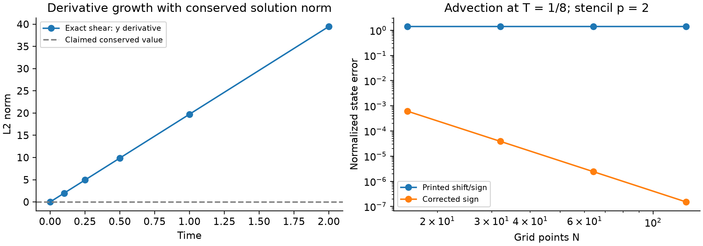
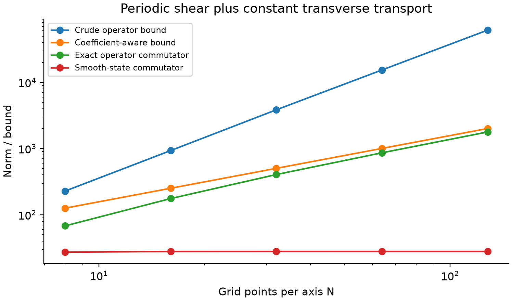
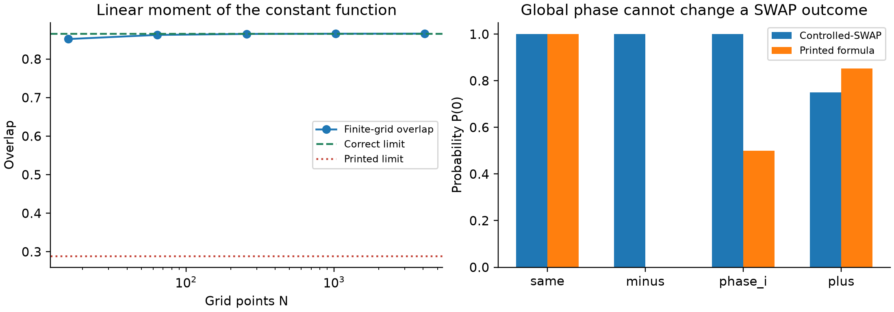

# Corrections and resource bounds for the Trotter quantum transport algorithm

**Taylor Kalin**

Independent researcher; https://taylorkalin.com

ORCID: 0009-0003-9000-9315; correspondence: teylersf@gmail.com
Version 1.1.0; 29 October 2026

## Abstract

We audit arXiv:2508.15691v2 and the published Quantum Science and Technology article *Trotter-based quantum algorithm for solving transport equations with exponentially fewer time-steps* by Zylberman, Fredon, Loureiro and Debbasch. Ten registered correction groups persist in the directly inspected journal PDF. Exact counterexamples refute conservation of spatial derivative norms for variable transport fields and the signed-overlap identity assigned to a controlled-SWAP circuit. Further corrections concern transport and Liouville signs, Fourier inversion, moment normalization, constants and index ranges. We retain finite-time regularity factors and apply established commutator reasoning to obtain a coefficient-aware finite-grid operator bound proportional to inverse mesh spacing rather than its square for smooth periodic coefficients. This sharpens the chosen comparison baseline without proving a complete repaired vector-norm theorem or disproving the usefulness of smooth-state analysis. Independent calculations reproduce the reported eight-point discretization errors and a separate periodic splitting diagnostic. A version concordance, attributed source statements and numerical provenance tables make the findings directly checkable. The journal's added Gaussian-width, circuit-cost and boundary qualifications are acknowledged. No end-to-end quantum advantage, general impossibility result or inference about unavailable implementation code is claimed.

## 1. Introduction

Encoding a discretized transport solution in quantum amplitudes can reduce the number of memory qubits dramatically. The remaining questions concern how that state is prepared, how accurately it evolves, what measurements return, and what resources each of these operations consumes. A statement about a time discretization bound answers only one of those questions. It should be judged on its own assumptions before being interpreted as a computational advantage over a classical solver.

The audited preprint [1] studies periodic transport with a velocity field whose component in each coordinate direction is independent of that same coordinate. It combines centered finite differences, quantum Fourier transforms and first-order product formulas. Its central analytical observation is sensible: an operator containing an increasingly fine discrete derivative can have a large worst-case norm while acting moderately on a fixed, smooth function. The paper compares a vector-dependent error estimate with a crude product of operator norms and reports an exponential reduction in the predicted number of steps as the number of qubits per coordinate grows.

Several details require correction before this conclusion can be used reliably. Smoothness is preserved for a finite time under a smooth transport flow, but its derivative norms need not retain their initial values. Two separately prepared states do not supply a phase reference through a SWAP test. A sign convention for a shift acting on ket labels has the opposite action on its amplitude array. These issues are algebraic and can be checked without access to a quantum computer. They are also distinct from whether the program unavailable in the inspected arXiv materials used the printed expressions literally.

This paper has three purposes. First, we identify reproducible failures in specified equations of the supplied edition. Second, we replace the incorrect derivative conservation argument and improve the operator-norm baseline using the structure of finite differences. Third, we delimit what survives: unitary directional transport, the practical benefit of smooth-state estimates, and the reported small-grid error magnitudes. This separation prevents a transcription error from being mistaken for a general impossibility result and prevents a valid numerical illustration from repairing an invalid proof step automatically.

Our contribution is a technical correction comment, not an authorized revision of the original authors' paper. The article appeared in *Quantum Science and Technology* 11, 025015 (2026), DOI 10.1088/2058-9565/ae488e [2]. Initial requests encountered a publisher challenge; a later ordinary publisher PDF request succeeded. We then directly inspected the journal text and verified that all ten correction groups registered for the supplied arXiv edition persist, with renumbered appendix equations. Section 3.1 reports the version concordance. The journal also adds substantive qualifications, which this revision credits rather than treating the two editions as identical.

## 2. Related work and mathematical setting

An, Fang and Lin [3] established the usefulness of vector-norm analysis for time-dependent Hamiltonian simulation with unbounded operators. Their treatment includes an unbounded kinetic operator and a bounded potential under stated commutator assumptions. The audited paper acknowledges that antecedent and addresses a different transport decomposition. Our counterexamples do not dispute the earlier theorem, nor do they establish that the transport paper has no new analytical content. They address specific claims in its extension and the interpretation of its comparison baseline.

The controlled-SWAP identity is established in the quantum fingerprinting literature [4]. Hadamard tests and quantum amplitude estimation [5] can estimate other quantities with suitable controlled preparation and access assumptions. These protocols are not interchangeable solely because each produces a scalar measurement. In particular, retaining a phase reference through a controlled preparation differs physically from comparing two independently prepared state registers.

Commutator-sensitive product-formula estimates are established theory [6]. Our Section 4.2 is an explicit application to finite-grid transport, not a new general splitting theorem. Burgarth et al. [9, Theorem 2] further show that the commutator on an initial state cannot universally certify finite-time error. Their stationary exact-trajectory example also rules out replacing it solely by its maximum along the exact trajectory. Actual defects involve intermediate split trajectories or additional product and remainder controls. Our initial-state commutator diagnostics therefore accompany independently calculated evolution errors; they are not error certificates. A separate contribution by the four transport authors treats anisotropic diffusion and convection [10]. Its arXiv v1 and Springer proceedings version are separately identified; this audit does not automatically establish any correction to that proceedings article.

Throughout, the spatial domain is the unit torus, with smooth periodic real velocity $c=(c_1,\ldots,c_d)$, and

$$
\partial_t f+c\cdot\nabla f=0. \tag{1}
$$

We adopt the original componentwise condition $\partial_j c_j=0$ when discussing its directional implementation. This implies $\nabla\cdot c=0$, so the continuum flow preserves volume and the solution's $L^2$ norm. It is stronger than divergence freedom. Unless stated otherwise, dimension, finite-difference order, final time and continuum input functions remain fixed while the grid is refined. Constants may depend on all of those fixed quantities.

Let $h_j=1/N_j$, $N_j=2^{n_j}$, and $a_k$ be the centered first-derivative coefficients of order $2p$, with $a_1=1/2$ for $p=1$. We distinguish a forward ket shift $S_j|x\rangle=|x+h_j e_j\rangle$ from a forward amplitude translation $\tau_{j,k}g(x)=g(x+kh_j e_j)$. They are inverse conventions. The consistent amplitude derivative used below is

$$
B_j={1\over h_j}\sum_{k=-p}^{p}a_k\tau_{j,k},\qquad B_j^\dagger=-B_j. \tag{2}
$$

The Hermitian transport Hamiltonian corresponding to (1) is $H=-i\sum_j C_jB_j$, because $-iH=-\sum_j C_jB_j$. Here $C_j$ is the diagonal matrix of samples of $c_j$. Under the componentwise condition, $C_j$ and $B_j$ commute. This sign convention will be kept explicit in every test.

## 3. Methodology and evidence boundary

The supplied PDF has 34 pages, 4,798,118 bytes and SHA-256 `8c3e5bf0c6c063bb96f383066c8a5640659e6a69a40a4d990e90901dd56d0fd2`. It is byte-identical to the official versioned arXiv v2 PDF. We read its full text and appendices, inspected displayed equations, and compared them against the official TeX archive [1]. We also read the full journal PDF [2] and visually verified the disputed formulas. The arXiv archive contains manuscript, bibliography and figure images, but not the original study's simulation programs or raw hardware outcomes. The journal supplies a data-availability statement; we did not obtain executable author code or a hardware job record. These are evidence-specific statements, not a claim that no code exists anywhere. Unless a journal locator is explicitly given, source equation/page references in Sections 4-5 retain arXiv v2 numbering; Section 3.1 and Appendix A provide their journal concordance and source statements.

We use two independent calculation scripts. `experiments/reproduce.py` generates analytical counterexample samples, finite-matrix checks, five CSV tables and three figures. `experiments/resource_counterchecks.py` independently checks the main measurement and convention examples, reproduces the reported hardware-discretization error magnitudes, and evolves a separate smooth periodic transport problem. Both use double-precision NumPy; Matplotlib is required only for the first script's figures. There is no fitting to experimental data, stochastic selection of favorable runs, or use of a local language model as a numerical oracle. The calculations use CPU arrays; releasing GPU memory is not a condition for these small checks.

We classify evidence at three levels. A literal equation failure is demonstrated by substitution or a finite matrix whose result contradicts the printed statement. A resource qualification identifies parameters hidden when an asymptotic assertion fixes an input family. An implementation uncertainty identifies what cannot be inferred from manuscript formulas without the actual program or data. The first level justifies correction; the second justifies narrower wording; the third justifies restraint rather than an accusation.

The main numerical tolerances are $10^{-11}$ for analytic shear quadrature and $10^{-12}$ for elementary SWAP identities. The translation test refines $N$ from 16 to 128. The commutator test uses $N=8,16,32,64,128$ per coordinate, exploiting a tensor factorization to evaluate the exact operator norm using only $N$-dimensional matrices. For the separate periodic evolution diagnostic, a 2,048-step Strang reference is compared with a 1,024-step reference to quantify reference error. That difference is reported alongside the first-order splitting error rather than assumed negligible silently.

The repository supplies source provenance, a correction registry, numerical outputs, environment versions, and a hash manifest. Appendix A quotes the audited statements and reproduces their equations with attribution. Appendix B defines the norms, gives matrix constructions, and tabulates numerical provenance within the paper. The tests are deliberately small and falsifiable. They verify algebra and illustrate limiting behavior; they are not a hardware replication, an assessment of fault-tolerant gate counts, or a benchmark against an optimized classical PDE code. Journal conclusions now rest on its downloaded text and rendered formulas, not metadata or indexed snippets.

## 4. Results: regularity and finite-grid resource bounds

### 4.1. Spatial derivatives are forced by velocity gradients

The paragraph following Theorem III.4 on p.12, its footnote 10, and the opening of Appendix B on p.29 assert conservation of the $L^2$ norm of every spatial derivative. The appendix argues that each derivative solves the original homogeneous transport equation. For variable $c$, differentiation gives instead

$$
(\partial_t+c\cdot\nabla)\partial_\ell f
=-\sum_j(\partial_\ell c_j)\partial_j f. \tag{3}
$$

The componentwise constraint removes $\partial_jc_j$, not every cross derivative. Thus it does not remove the right-hand side of (3). Volume preservation conserves $\|f\|_2$; it does not remove deformation of level sets or amplification of gradients.

An exact smooth periodic counterexample satisfying every componentwise condition is

$$
c(x,y)=(\sin(2\pi y),0),\quad f_0(x,y)=\sin(2\pi x),\quad
f_t(x,y)=\sin(2\pi[x-t\sin(2\pi y)]). \tag{4}
$$

Direct integration gives

$$
\|f_t\|_2=2^{-1/2},\qquad
\|\partial_x f_t\|_2=\sqrt2\pi,\qquad
\|\partial_y f_t\|_2=2\pi^2|t|. \tag{5}
$$

The last norm grows from zero to 19.7392088 at time one. This is a continuum counterexample, not an aliasing effect. The sampled quadrature agrees with (5) to the stated tolerance. A nonnegative version follows by adding a constant to $f_0$; the derivative contradiction remains unchanged. Consequently, interpreting the encoded function as a nonnegative density does not rescue the conservation claim.

There is a constructive replacement. Let $\Phi_t$ be the flow map of $c$, so $f_t(\Phi_t(a))=f_0(a)$. Differentiating with respect to $a$ yields

$$
\nabla f_t(\Phi_t(a))=D\Phi_t(a)^{-T}\nabla f_0(a). \tag{6}
$$

Since $\det D\Phi_t=1$ for a divergence-free field, the usual flow estimate implies

$$
\|\nabla f_t\|_2\leq
\exp\!\left(\int_0^t\|\nabla c(\cdot,s)\|_{\mathrm{op},\infty}\,ds\right)
\|\nabla f_0\|_2. \tag{7}
$$

Equation (7) bounds the entire gradient, not each component by its own initial component. It therefore permits a zero initial $y$ derivative to become nonzero. For integer $s\geq1$, the multi-index identity

$$
(\partial_t+c\cdot\nabla)D^\alpha f
=-\sum_{0<\beta\leq\alpha}{\alpha\choose\beta}
(D^\beta c)\cdot\nabla D^{\alpha-\beta}f \tag{8}
$$

gives an $H^s$ energy bound with a factor
$\exp(C_{s,d}\int_0^t\|\nabla c\|_{W^{s-1,\infty}}ds)$, under integrable coefficient bounds and periodic sufficiently regular data. This follows by multiplying differentiated equations by $D^\alpha f$, integrating, using divergence freedom on the transport term, and applying Cauchy-Schwarz and Gronwall. It supplies finite-time regularity constants without asserting derivative conservation.

The theorem's displayed leading coefficient already retains a maximum over time of derivative norms [1,2]. Such a coefficient remains a candidate for a corrected estimate. The invalid step is replacing those norms with their initial values and describing all time dependence by an explicit factor $T^2$. A defensible estimate keeps $K_T$ and the time-dependent derivative ratios visible. It can remain independent of mesh spacing for fixed smooth inputs and finite time while depending strongly on final time, velocity gradients, localization, and dimension. The flow estimate (7)-(8) alone does **not** prove original Theorem III.4 or journal Theorem 3.4. A complete repair still has to control mixed split trajectories, the replacement of a discrete state by sampled continuum data, and all additive remainders. We do not supply that full repaired theorem here; its unrestricted conclusion remains unestablished by this audit.

### 4.2. A coefficient-aware operator comparison

The paper [1,2] obtains its $O(4^n)$ comparison from bounding a commutator by a product of two derivative operator norms, each $O(N)$ for $N=2^n$ grid points per coordinate. Smooth coefficients permit cancellation before any state-dependent argument is introduced, as in established commutator-scaling analysis [6]. Define

$$
A_p=\sum_{k=-p}^p|a_k|,\qquad
M_p=\sum_{k=-p}^p|k a_k|. \tag{9}
$$

Periodic Lipschitz continuity gives the exact finite-grid identity and bound

$$
[B_j,C_m]=\sum_k {a_k\over h_j}
[c_m(x+kh_j e_j)-c_m(x)]\tau_{j,k},\qquad
\|[B_j,C_m]\|\leq M_p\|\partial_j c_m\|_\infty. \tag{10}
$$

This follows term by term from the mean value estimate; translations are unitary. It requires coefficients smooth across the periodic seam. A discontinuous periodized linear coordinate function does not satisfy that hypothesis globally. Both audited editions explicitly allow inherently periodic transport, so the estimate applies to that smooth periodic subclass. It is not a global operator estimate for arbitrary compactly supported data combined with a discontinuously periodized velocity. Localization of a solution away from a seam does not remove a global operator-norm jump there. Applying this sharpened baseline to the paper's linear-coordinate examples would require a specified smooth periodic extension, or a different localized argument, which is not assumed here.

Since the coordinate differences commute,

$$
[C_jB_j,C_mB_m]
=C_j[B_j,C_m]B_m-C_m[B_m,C_j]B_j. \tag{11}
$$

Combining $\|B_j\|\leq A_p/h_j$ with (10) gives

$$
\|[C_jB_j,C_mB_m]\|\leq A_pM_p
\left({\|c_j\|_\infty\|\partial_jc_m\|_\infty\over h_m}
+{\|c_m\|_\infty\|\partial_mc_j\|_\infty\over h_j}\right). \tag{12}
$$

For fixed order and balanced meshes, (12) is $O(N)$ rather than $O(N^2)$. For autonomous skew-Hermitian directional generators, the double-integral Duhamel representation of first-order Lie splitting bounds a local defect by $\Delta t^2/2$ times the sum of pairwise commutator norms. Unitarity lets local errors telescope without norm amplification. The global bound is therefore $T^2/(2L)$ times that sum. This standard argument applies directly to (12); it does not require estimating a derivative norm of the state. Endpoint freezing of a time-dependent coefficient adds a term controlled by its time derivative and $\|B_j\|$, again $O(N)$ under the corresponding fixed bounds. We restrict the constructive splitting statement here to the autonomous case to avoid claiming a full new time-dependent theorem.

For $c_1(y)=\sin(2\pi y)$, $c_2=1$ and $p=2$, the commutator factorizes. The exact operator norm grows from 67.8300 at $N=8$ to 1782.5930 at $N=128$. The crude bound grows from 227.5556 to 61676.6654, while (12) gives 125.6637 and 2010.6193. On the fixed smooth state proportional to $\sin(2\pi x)$, the commutator norm approaches 27.9154568. These values separate three distinct quantities: a crude worst-case bound, a sharper worst-case bound, and action on a chosen smooth state.

Equation (12) does not invalidate the reported factor relative to the specific $O(N^2)$ baseline. It shows that the factor is not a lower bound on how many steps operator-norm methods require. Relative to this sharper baseline the displayed leading comparison is $N=2^n$, still exponential in qubits, rather than $N^2=4^n$. Neither comparison establishes an end-to-end quantum/classical speedup. No novelty priority is claimed for the elementary commutator identity itself; its role here is to make the comparison in this particular audit explicit.

### 4.3. The asymptotic regime must couple space and time refinement

Appendix B retains remainders of the form

$$
R_q=O\!\left({T^q\over L^{q-1}h^q}\right),\quad q=3,4,5. \tag{13}
$$

With $L$ proportional to $T^2/\epsilon$ and a balanced mesh $h$ proportional to $(\epsilon/T)^{1/(2p)}$, fixed $T$ and fixed regularity constants, their epsilon exponent is $q-1-q/(2p)$. The worst listed case, $q=3,p=2$, is $5/4>1$, so these terms are smaller than $\epsilon$ as $\epsilon\to0$. This supports the paper's coupled asymptotic reasoning after its other corrections.

By contrast, refining the grid arbitrarily while holding $L$ fixed makes the displayed bounds in (13) grow. It is therefore not justified to describe this proof as uniform in every grid refinement at a fixed step count. The actual error may plateau on a particular smooth family, as our separate experiment does; a divergent upper bound does not prove a divergent actual error. Conversely, that plateau does not supply the missing uniform proof for all permitted inputs.

The discussion following Appendix B Eq.(B20) also miscounts an exponent. At fixed $T$, $Lh_t^2 h^{2p-2}$ with $h_t=T/L$, $L\asymp\epsilon^{-1}$ and $h\asymp\epsilon^{1/(2p)}$ scales as $\epsilon^{2-1/p}$, rather than the printed $\epsilon^{2-1/(2p)}$. For $p\geq2$ this correction remains higher order than $\epsilon$. It changes the formula, not the asymptotic conclusion in that regime. We use $\asymp$ here to specify balanced refinement; a one-sided big-O mesh choice alone does not control inverse powers of the mesh.

## 5. Results: measurement and equation corrections

### 5.1. Controlled-SWAP measures squared overlap

Appendix A.3.b, Eqs.(A15)-(A16), and Fig.14 on pp.27-28 show a standard controlled-SWAP circuit. Its final unnormalized ancilla-zero branch is

$$
{ |\psi\rangle|\phi\rangle+|\phi\rangle|\psi\rangle\over2}.
$$

Squaring its norm yields

$$
P(0)={1+|\langle\phi|\psi\rangle|^2\over2},\qquad
P(1)={1-|\langle\phi|\psi\rangle|^2\over2}. \tag{14}
$$

The paper replaces the squared magnitude by the real overlap. Taking $\phi=|0\rangle$ and $\psi=-|0\rangle$ makes the contradiction immediate: (14) gives $P(0)=1$ while the printed expression gives zero. The two preparations differ by a global phase, so no measurement on the two independent density operators can distinguish this case from $\psi=|0\rangle$. For $\psi=|+\rangle$, the correct probability is $3/4$ while the printed value is approximately 0.8535534.

Inserting a phase gate $\operatorname{diag}(1,i)$ on the control changes the interference term to the imaginary part of the SWAP expectation. That expectation is the real number $|\langle\phi|\psi\rangle|^2$. The new probability is $1/2$, not a measurement of the imaginary overlap. This also invalidates the stated use of the displayed SWAP circuit to recover a general signed or complex expectation by preparing a block-encoded transformed state.

The Hadamard-test route remains available: controlled access to a preparation or a block encoding provides a relative phase against a reference branch and can estimate the corresponding real and imaginary matrix elements, with the phase-gate sign handled consistently. The QAE construction explicitly assumes nonnegative overlap in its stated setup. Our result is thus a correction of one measurement construction, not a claim that the proposed observables are unmeasurable by any circuit.

### 5.2. Polynomial overlap normalization

For the linear moment overlap in Eq.(17), define $w_k(x)=\prod_j x_j^{k_j}$ and $\mathcal N_k^2=\sum_Xw_k(X)^2$. The finite-grid formula has the denominator $\mathcal N_k\|f_0\|_{2,N}$. Riemann convergence gives

$$
\mathcal N_k\sim {\sqrt{N_{\rm tot}}\over\sqrt{\prod_j(2k_j+1)}},\qquad
\|f_0\|_{2,N}\sim\sqrt{N_{\rm tot}}\|f_0\|_{L^2}. \tag{15}
$$

The numerator is asymptotic to $N_{\rm tot}\int w_k f$. Hence the continuum coefficient multiplying $\int w_k f/\|f_0\|_{L^2}$ is $\sqrt{\prod_j(2k_j+1)}$, the reciprocal of the coefficient printed immediately after Eq.(17). For $d=1,k=1,f=1$, the normalized overlap tends to $\sqrt3/2=0.8660254$, not $1/(2\sqrt3)=0.2886751$. The independent calculation at $N=65536$ gives 0.8660221. The finite-grid definition need not be changed; its continuum interpretation does.

### 5.3. Shift convention and zero-time propagator

With the paper's explicit shift $S|x\rangle=|x+h\rangle$, the coefficient of $|x\rangle$ in $S|f\rangle$ is $f(x-h)$. Therefore its printed Eq.(5), $D=-i\sum_ka_k S^k/h$, satisfies $iD\approx-\partial_x$ on amplitudes, whereas Lemma III.1 asserts $iD\approx+\partial_x$. Equation (6) then evolves in the reverse transport direction relative to Eq.(1). A consistent repair is to replace $S^k$ by $S^{-k}$ in Eq.(5), retaining the downstream intended derivative convention; equivalent coordinated sign changes are possible.

For normalized samples of $\cos(2\pi x)$ at $T=1/8$, the literal printed generator has state error 1.41421345 at $N=128$ against positive advection, approaching $\sqrt2$. Reversing the Hamiltonian sign gives error $1.51958\times10^{-7}$ and the expected fourth-order convergence for $p=2$. This distinguishes a vanishing discretization error from a direction error. It also shows why Hermiticity and norm preservation alone do not establish that the intended PDE is being solved.

Independently, Eq.(39) on p.15 places a QFT on both sides of the diagonal exponential, while Eq.(14) requires inverse transforms on opposite sides. At time zero the printed product is $F^2$, which reverses nonzero Fourier indices for a standard QFT, rather than the identity. For the eight-component initial state used in Fig.7, $\|F^2f_0-f_0\|=\sqrt{3/2}=1.22474487$. Replacing the left QFT by its inverse repairs this identity check, after the derivative sign convention has been coordinated. Hidden implementation conventions cannot make two mutually contradictory displayed formulas simultaneously correct as written.

### 5.4. Lotka-Volterra Liouville sign

Equation (42) correctly gives $\dot q=-\alpha+\beta e^{-p}$ and $\dot p=\delta-\gamma e^{-q}$. Since this field is divergence-free, its density satisfies $\partial_t\rho=-\dot q\,\partial_q\rho-\dot p\,\partial_p\rho$. The correct right-hand side is

$$
\partial_t\rho=(-\delta+\gamma e^{-q})\partial_p\rho
+(\alpha-\beta e^{-p})\partial_q\rho. \tag{16}
$$

The second coefficient has the opposite sign in printed Eq.(43). With the paper's parameters, the physical fixed point is $(q,p)=(1/2,1/2)$. Linearizing the correct characteristic dynamics gives eigenvalues $\pm i\sqrt{\alpha\delta}=\pm0.55803515i$. Characteristics implied by the printed Liouville equation instead have real eigenvalues $\pm0.55803515$. The distinction is a center versus a saddle, so the literal equations cannot describe the same local dynamics. Without the program that generated the figures, we do not assert that it evolved the printed wrong-sign equation.

### 5.5. Additional local constants and index ranges

Below Eq.(26), p.11, the stated derivative bound uses $C_p=\sum_{q=0}^p a_q$ without absolute values. At $p=2$ this predicts a dimensionless symbol bound $2C_p=7/6$. The exact $N=32$ symbol maximum is 1.37149428, exceeding 1.16666667. The replacement $C_p=\sum_{q=0}^p|a_q|$ gives the valid bound $2C_p=1.5$. Appendix B already uses this absolute-value definition. This is a local inconsistency that preserves the claimed order in mesh spacing when repaired.

The compact maximum bound for $\alpha'_g$ in Theorem III.4 ranges only over $m<j$. It omits the opposite orientation of each pair. For $c_1=1,c_2(x)=\sin(2\pi x),f_0(y)=\sin(2\pi y)$, the full displayed pair sum is positive, while that oriented maximum is zero because $\partial_yc_1=0$. Maximizing over all distinct ordered indices repairs the compact inequality with the same $d(d-1)/2$ prefactor. The longer pairwise expression does not have this defect.

Two local Walsh-series statements also need ordinary index and error-budget corrections. Eq.(A5) sums indices from zero through $M$ inclusive, although an $M$-point Walsh representation has indices zero through $M-1$. With $f=1$ on a dyadic grid, the extra sampled Walsh function at index $M$ duplicates the constant function, giving two rather than one. Separately, the multidimensional bound in Eq.(A10) is a sum of $d$ axis errors. Choosing each $M_i\geq\|\partial_i f\|_\infty/\epsilon$ proves only $d\epsilon$; allocating $\epsilon/d$ to each axis proves the claimed $\epsilon$ accuracy. Appropriate powers of two and at least one term should be used for the dyadic grids. Neither correction by itself refutes the existence of efficient approximate diagonal circuits.

